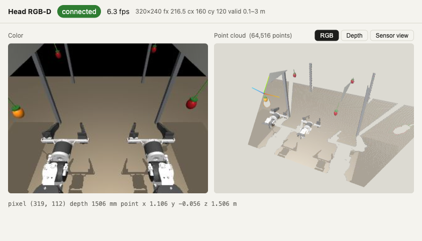

# OpenArm Teleop Sim

第一阶段：不用实体硬件，用 MuJoCo 里的 OpenArm v1 双臂（立柱款，16 个执行器：每臂 7 关节 + 夹爪），打通"控制指令 → 边缘安全层 → 状态反馈 → 浏览器前端"。

双臂默认装在移动底盘上：[Stanford TidyBot](https://github.com/google-deepmind/mujoco_menagerie/tree/main/stanford_tidybot) 的底盘（MuJoCo Menagerie，MIT 许可，只用底盘，不含它的 Kinova 机械臂）。底盘是全向的，用 x、y、转角三个平面关节做位置控制，没有轮子物理。OpenArm 的立柱下半截（含底座支架）沉进底盘里 0.18 m，肩高约 0.85 m（`edge/mujoco_adapter.py` 里的 `COLUMN_SINK`）。手臂完全垂下时指尖在肩下 0.63 m，会碰到底盘顶面，所以遥操作加了禁区：在底盘上方，夹爪最低停在底盘顶面上方约 5 cm；其他地方停在地面上方约 2 cm；从侧面低处靠近底盘时停在边缘。启动时加 `--no-base` 回到固定立柱版。

场景是温室高架草莓（`edge/greenhouse.py`）：过道两侧各一排白色栽培槽，槽底离地 0.80 m，两槽内侧相距 0.68 m，底盘在过道里前后开。成熟的草莓挂在槽靠过道一侧的边上、槽底下方 10 cm，左排用左臂、右排用右臂。这些尺寸是按这台机器人的够得着范围定的，不是某个真实温室的实测值；真实高架槽常常更高，方便人站着摘，那样需要更高的立柱。手臂开了重力补偿（真机控制器同样会做），否则夹爪会比目标低约 2.5 cm。


## 运行

```bash
./scripts/fetch_model.sh                 # 拉取 OpenArm 模型和 TidyBot 底盘（固定 commit）
uv run pytest                            # 安全层、IK、遥操作、任务和仿真适配器测试
uv run python -m edge.server             # http://127.0.0.1:8765
```

操作顺序：Claim control → Activate（手柄 Start）→ 用手柄移动夹爪。面板 Control 一行可以直接点选 Left arm / Right arm / Base；也可以按手柄 □ 或键盘 Tab 在手臂和底盘模式间切换。方向键和手柄十字键在任何模式下都直接开底盘。点 Start task 开始采摘任务。没有手柄时用键盘，按键见页面里的 Controls。

| 动作 | 手柄（PS4） | 键盘 |
|---|---|---|
| 切换手臂 / 底盘模式 | □ | Tab |
| 开底盘（任何模式）：前进后退 / 左右转 | 十字键 ↑↓ / ←→ | 方向键 ↑↓ / ←→ |
| 手臂模式：夹爪左右、前后移动 | 左摇杆 | A D / W S |
| 手臂模式：夹爪上下移动 | 右摇杆 | R / F |
| 手臂模式：合上夹爪 | 按住 R2 | 按住 G |
| 切换左臂 / 右臂（回到手臂模式） | L1 / R1 | Q / E（手臂模式下） |
| 底盘模式：底盘左右、前后平移 | 左摇杆 | A D / W S |
| 底盘模式：原地左转 / 右转 | 右摇杆左右 | Q / E |
| Activate / Home（只回手臂，底盘不动）/ E-stop | Options / △ / ○ | Enter / H / 空格 |

画面有两个标签：**3D view**（默认）在浏览器里按关节状态画出机器人，可拖动旋转、滚轮缩放、右键平移，右上角有 Robot / Front / Left / Right / Top 预设视角；**Robot camera** 是边缘端渲染的相机画面，相机装在底盘后上方，跟着底盘走和转（将来对应真机相机）。底盘移动时 3D 视图只跟着平移、不跟着转，所以摇杆方向不会在操作中突然变；预设视角以底盘当前位置和朝向为准。3D 视图需要 WebGL，three.js 从 jsDelivr CDN 加载。

头顶 RGB-D 相机：立柱顶上加了一根 10 cm 的短杆，相机略靠前（避开肩部外壳），离地约 1.03 m，向下 45°，能同时看到两只夹爪、近处的草莓和前方过道（`edge/rgbd.py`）。点画面上方的 **RGB-D window ↗** 打开单独窗口：左边是彩色图，右边是点云。点云由每个深度像素按相机内参反投影得到，可以拖动旋转、滚轮缩放，按相机安装角放平（地面是水平的）；可选按彩色图上色或按深度上色，Sensor view 回到相机视角。鼠标停在彩色图上显示该像素的深度和相机坐标系下的 3D 点。320×240，竖直视场 58°，深度有效范围 0.1–3 m，范围外记为 0（无返回）。彩色和深度用同一个虚拟相机渲染，像素天然对齐；真实传感器需要做深度到彩色的配准。这个窗口只看不控制，不需要 Claim。



方向以当前画面为准：摇杆向上 = 画面里向前，开底盘和动手臂都一样。在 3D 视图里转到哪个方向，摇杆就跟着那个方向。只控制夹爪中心的位置，不控制手腕姿态。夹爪目标记在底盘坐标系里，所以开底盘时手臂跟着车走，姿态不变。勾选 "Stop sending commands" 可模拟断网。

采摘任务：过道长 10 m，8 颗草莓按顺序高亮（琥珀色），左右排交替。前两颗原地就能够到，后面六颗分布在过道 1.6–8.6 m 处，要开底盘过去（底盘可在 x −1.5…10 m 内开）。摘法：夹爪张开从后面伸过去，让两指在草莓两侧，合上夹爪，往回拉下来，再把草莓带到底盘前部的小筐上方松开。两指都压在草莓上、而且草莓在两指之间（不超出夹爪中心前方 1.2 cm）时，草莓才从梗上脱落；只用指尖勾住后沿不算，草莓留在梗上。**草莓靠物理引擎掉进筐里**，在筐里静止 0.5 s 才算完成，变绿；筐有碰撞，草莓跟着底盘走。掉在筐外要重新开始（Start task 会把草莓全部挂回去）。页面显示草莓状态（on the stem / in the gripper / in the basket / dropped），页面和 `logs/` 记录每颗的用时和由哪只手摘下。固定立柱版（`--no-base`）没有筐，仍按"摘下并拉开 5 cm"计。

## 两个场景

页面顶部可以切换场景（没人在开、也没有自主运行时才能切）。两个场景用同一台机器人、同一套控制和数据格式。

- **高架草莓**（`edge/greenhouse.py`）：上面描述的温室过道，6 颗草莓。
- **土垄大棚除草**（`edge/tunnel.py`）：10 m 长的拱棚里两条土垄，底盘在中间的沟里开。土垄截面是梯形（底宽 0.60 m、顶宽 0.46 m、高 0.25 m，两头也是斜坡），表面是起伏的土块（约 ±1 cm，固定随机种子，每次一样），沟底也不平。看起来是土而不是地板：MuJoCo 相机和 RGB-D 用随机斑点的土壤贴图，浏览器 3D 视图用程序生成的土壤纹理（带凹凸），不画地面网格。碰撞用每条垄一个光滑的梯形棱柱，只有外观的那层才有土块。土垄中线种一排作物苗（只有外观），靠沟一侧长着 8 棵杂草（黄绿色，和深绿的作物区分）。拔法：夹爪从上方下来，两指夹住草茎，合上后往上提；脱离土壤的规则和草莓脱梗相同；拔出来的草直接扔掉，不进筐。**土垄的形状是按这台机器人的够得着范围定的**：手臂按高架草莓的高度装（肩高约 0.85 m），夹爪最低只能到离地约 0.30 m、往侧面只能伸到约 0.38 m，所以垄高 0.25 m、靠沟一侧的坡很陡（约 75°），坡脚紧挨着底盘。更矮、坡更缓的垄要么把手臂装低，要么换底盘，这是底盘和安装高度的设计问题，仿真里没有解决。底盘在沟里开时两边各只剩约 1 cm 余量，而且没有轮子物理，不反映真实沟底的颠簸和陷车。

## 自主运行和求助单

点 **Run autonomously**，机器人按顺序自己干：回 Home → 开底盘到目标后方 → 夹爪到预备点 → 伸进去 → 合上 → 拉（`edge/autopilot.py`）。它发的指令和浏览器发的完全一样（摇杆速度、夹爪、Home），走同一个安全层，记录格式也一样。

遇到下面两种情况它会停下来（HOLD）并发出**求助单**：

1. **场景里标成"难"的目标**：草莓第 3 颗（叶子挡住）、第 5 颗（熟没熟）；杂草第 2 棵（长得像作物苗）、第 5 棵（不认识的植物）。仿真里没有感知，这几张单子是写死的，代替真实感知会拿不准的情况。
2. **自己失败**：某个阶段超时（够不到、没脱梗、拉的时候掉了）。

任何在看的人都可以点 **Take over** 接单，接单后直接进入 ACTIVE，用手柄或键盘把这个目标做完；做完后控制权自动交还，机器人接着做下一个。做不了可以点 **Give up on this one** 跳过。自主运行时有人点 Claim control 也算接管（没有单子），释放后机器人从当前目标重新开始。E-stop 会结束自主运行，要重新点 Run。Start task (manual) 是原来的纯手动模式。

## 数据记录和回放

不管是机器人自己做还是有人接管，每个目标的每次尝试都记成一个 **episode**：从这个目标开始，到完成（success）、跳过（skipped）或中断（aborted：停止运行、重来、切场景、超过 300 s）为止。中间谁在操作逐步记录，交接本身（求助单、接管、交还）就在数据里。

- 文件：`episodes/<id>.json`，另在 `episodes/index.jsonl` 每个 episode 追加一行摘要（列表用），头顶 RGB-D 帧在 `episodes/<id>/rgbd/00000.bin` 起，一帧一个文件。格式 `openarm-episode/v0`，字段说明在 `edge/episodes.py` 开头。
- 每步（20 Hz）一行，按列存：时间、谁在操作（`auto` / `human` / `none`）、安全层模式、实测关节、关节目标、底盘位姿、两只夹爪位置、目标位置、是否还连着梗或土、这一步执行的指令（`ee` / `base` / `home`，和浏览器协议同一种形式）。
- 另外存：结果（谁完成的、原因）、按操作者切分的片段、求助单（时间、代码、说明）、事件（安全层模式变化、脱梗、接管、释放），以及 10 Hz 的各 link 位姿（只用于 3D 回放，可由关节和物体位置推出）。
- 不记名字：操作者只记 `client N`；会话日志里有 client 编号和邀请标签的对应，只在服务器上。
- 头顶 RGB-D：最多 5 fps，实际受渲染速度限制（这台 Mac 上约 4 fps；EC2 软件渲染约 1 fps，而且和 Robot camera 共用渲染线程）。每帧和 `/rgbd` 实时流同一格式：4 字节长度 + JPEG 彩色 + zlib 压缩的毫米深度。JSON 里 `rgbd.camera` 是内参和安装角，`rgbd.frames` 是每帧的时间和文件名。帧是在控制循环外渲染的，时间戳记的是拍摄那一刻的仿真状态，不是渲染完成的时间。
- 大小：步数据每秒约 20 KB（大部分是 3D 回放用的位姿）；RGB-D 每帧在草莓场景约 23 KB、除草场景约 77 KB（土块的深度压缩率差），4 fps 时除草每秒约 0.3 MB，一小时约 1 GB。服务器上要留意磁盘。

页面右上的 **Episodes ↗** 打开回放面板（`web/replay.html`）：左边是列表（按场景、结果、是否有人帮过筛选，顶上是成功率、求助次数），右边是选中的 episode：3D 回放（播放、0.5–4 倍速、拖动），下面是光标时刻的头顶相机彩色图和深度图（深度按 0.2–2 m 着色，黑色 = 无返回），时间轴（蓝 = 机器人、橙 = 操作员、灰 = 没人在操作；红三角 = 求助单，竖线 = 事件），曲线（夹爪到目标的距离、夹爪开合、摇杆幅度），光标处的全部字段，事件列表（点击跳转），下载 JSON。

## 托管演示（v0：发链接给投资人和合作伙伴）

一台 EC2（Ubuntu 24.04，默认 c7g.xlarge），Caddy 负责 HTTPS 证书并反向代理到本机的 `edge.server`，systemd 守护进程。没有 GPU，相机画面用 Mesa 软件渲染（`MUJOCO_GL=osmesa`）；3D 视图在浏览器里画，不占服务器。所有人共用一个仿真：一次一个人开，其他人旁观，3 分钟没有操作自动释放控制权。

- **邀请制**：每人一条专属链接 `https://<站点>/?code=…`。第一次打开后链接里的码换成 HttpOnly cookie，地址栏里不再出现。码放在服务器的 `/etc/openarm-teleop/codes.txt`，增删立即生效，不用重启：`sudo teleop-invite add "姓名, 公司"` / `list` / `revoke "姓名, 公司"`。没有有效码时页面和 WebSocket 都返回 403；`/healthz` 不需要码。
- **日志不记 IP**：会话日志记的是邀请标签（谁）和操作，不记来访 IP。
- **上线**（本机装好 AWS CLI）：`REGION=eu-central-1 ./deploy/ec2-launch.sh`。脚本创建密钥对、安全组（80/443 对外，22 只对你当前 IP）、弹性 IP 和实例；首次开机自动跑 `deploy/setup.sh`（约 5 分钟，含无头渲染自检 `python -m edge.selftest`）。没有自己的域名时用 `<弹性IP>.sslip.io`，有的话加 `SITE=demo.example.com` 并把 DNS A 记录指向弹性 IP。
- **省钱**：不演示时 `aws ec2 stop-instances` 停机，弹性 IP 保留，链接不变。全部删除：`CONFIRM=yes ./deploy/ec2-teardown.sh`。

## 结构（与真实边缘设备一一对应）


| 文件 | 作用 | 换成真机时 |
|---|---|---|
| `edge/mujoco_adapter.py` | 机器人替身：把双臂装到底盘上；关节名、限位（底盘限制在起点 ±1.5 m 内）、读状态、写目标；草莓何时从梗上脱落；相机画面（在单独线程里渲染） | 换成 ROS 2 或供应商 SDK 适配器，接口不变 |
| `edge/rgbd.py` | 头顶 RGB-D 相机：安装位置、内参、帧打包（JPEG 彩色 + zlib 压缩的毫米深度） | 换成真实相机驱动（如 ROS 2 的 image 和 depth 话题），帧格式可保留 |
| `edge/greenhouse.py` | 温室场景：10 m 栽培槽、支架、植株（只有外观）、挂在梗上的草莓、底盘上的筐 | 真机时就是真实温室 |
| `edge/tunnel.py` | 拱棚场景：梯形土垄（带土块的外观网格 + 光滑的碰撞棱柱）、土壤贴图、作物苗（只有外观）、长在土里的杂草、拱架 | 真机时就是真实大棚 |
| `edge/autopilot.py` | 写死路径点的自主程序：各阶段、超时、求助单；每个场景一套路径点和"难"目标 | 换成真实的感知 + 规划；求助单接口保留 |
| `edge/episodes.py` | episode 记录：格式、按列存每步、片段、事件、索引 | 保留；真机时同样字段来自机器人状态 |
| `edge/ik.py` | 单臂位置 IK：阻尼最小二乘，零空间拉向初始姿态 | 换成真机的模型，算法不变 |
| `edge/teleop.py` | 摇杆速度（画面坐标）→ 夹爪目标（底盘坐标系）→ IK → 关节目标；够不到时目标不再往外跑。底盘模式把摇杆积分成底盘 x、y、转角目标 | 保留；关节名表按机器人改 |
| `edge/task.py` | 采摘任务：顺序、成功判定（脱梗、在夹爪里、拉开 5 cm）、每颗用时 | 保留 |
| `edge/scene.py` | 3D 视图用的模型网格（体素聚类降采样，约 2 MB）和各 link 位姿 | 真机时位姿来自 `/joint_states` 正运动学 |
| `edge/safety.py` | 本地安全层：限位裁剪、速度限制、0.5 s 看门狗、E-stop 锁存 | 原样保留，跑在机器人本地 |
| `edge/server.py` | 100 Hz 本地控制循环 + WebSocket；单操作员控制权，空闲 3 分钟自动释放；JSONL 会话日志（`logs/`） | 保留 |
| `edge/access.py` | 邀请码：链接换 cookie、按文件增删、命令行工具 | 换成正式账号体系前沿用 |
| `deploy/` | EC2 上线 / 删除脚本、首次开机安装脚本、systemd 服务、Caddy 配置 | 按云环境调整 |
| `web/` | 操作员界面：3D 视图、相机画面、手柄 / 键盘输入、任务面板、自主运行和求助单、场景切换、模式、RTT；`rgbd.html` 是单独的 RGB-D 窗口（彩色图 + 点云）；`replay.html` 是 episode 回放面板 | 保留 |

协议：浏览器以 20 Hz 发送 `ee`（当前手臂、三轴速度 −1…1、夹爪 0…1；在 3D 视图里另带 `yaw`，即视角朝向），开底盘时改发 `base`（右、前、右转三个分量 −1…1，同样可带 `yaw`），边缘端以 20 Hz 回 `state`（含各 link 位姿）。浏览器切换画面时发 `view`，JPEG 只发给正在看 Robot camera 的客户端，最多约 14 fps；渲染在单独线程里做，GPU 读回慢时只会降帧率，不会卡住控制循环。RGB-D 走另一个 WebSocket `/rgbd`，只读：连上先收一条 `rgbd_hello`（分辨率、fx、fy、cx、cy、安装俯角、有效范围），之后每帧一条二进制消息：4 字节小端长度 n、n 字节 JPEG 彩色、zlib 压缩的 uint16 小端深度（毫米，按行排列）。最多 10 fps，和相机画面共用同一个渲染线程，没人看时不渲染。网格只在打开页面时从 `/scene.json`、`/scene.bin` 取一次。发送的是速度而不是位置，所以丢一包只会短暂停顿。IK 的结果仍要经过安全层，高频伺服不经过网络。底盘的三个目标和手臂关节走同一个安全层：限速 0.5 m/s、1 rad/s，断联 HOLD，E-stop 停在实测位置。

## 已验证

- 目标超出限位会被裁剪；setpoint 移动速度不超过 1 rad/s。
- 停发指令 0.5 s 后进入 HOLD，停在当前 setpoint；重新 Activate 时不跳变。
- 反复 HOLD/Activate 不会因重力下垂而累积漂移。
- E-stop 锁存，必须重新 Activate；任何连接的客户端都能触发 E-stop。
- 满杆时夹爪按 0.15 m/s 移动；消息间隔超过 0.1 s 不补算；目标够不到时不会越跑越远。
- 前两颗草莓原地可达，后四颗原地够不到，底盘开到草莓后方 0.40 m 处就能够到（IK 误差都在遥操作允许的 1 cm 一半以内）。
- 仿真里摘草莓：草莓挂着不动（下垂 < 1 mm）；夹住后脱梗，拉回过道时仍在夹爪里，任务计为完成；Start task 把草莓挂回原处。夹爪偏 1–1.5 cm 仍能摘下；只勾住后沿时草莓留在梗上，不会脱落后又掉。
- 开底盘到 3.7 m 处摘下第 5 颗；底盘带着手臂（Home 姿态）走完整条过道（x −1.0…9.5 m），不碰槽、支架或草莓。
- 渲染一帧相机画面耗时 1 s 时，控制循环照常 20 Hz 发状态；只有看 Robot camera 的客户端收到 JPEG。
- 浏览器中跑通（开着 3D 视图，脚本通过 WebSocket 操作）：摘下第 1 颗（8.8 s），Home，底盘向前开 0.56 m，全程保持 ACTIVE。
- RGB-D：帧打包和解包后深度误差 < 0.5 mm，超出范围记为 0；画面中心像素的深度与沿光轴的射线检测一致（1 cm 内）；用内参把两只夹爪和近处两颗草莓投影到图像里都在画面内，草莓处的深度与几何一致（3 cm 内，即果面）；底盘前进 0.3 m，相机跟着走 0.3 m；RGB-D 帧只发给 `/rgbd` 客户端。
- 浏览器中打开 RGB-D 窗口：连上后约 6–8 fps（这台机器上每帧渲染约 0.13 s），点云约 6.7 万点，RGB / Depth 上色切换正常，主界面同时保持 ACTIVE。
- 之前的版本中，浏览器用模拟手柄跑通过：手柄 B 触发 E-stop，Start 恢复。
- 3D 视图：五个预设视角和拖动旋转正常；在 Left 视角按"前"，指令带 yaw = −90°，夹爪朝远离镜头方向移动。
- 禁区：仿真里把两只夹爪压到底盘上方和底盘前方，手臂任何部位都不碰底盘。
- 底盘：满杆前进 0.4 m/s、转向 0.8 rad/s；底盘转 90° 后，夹爪仍按画面方向移动；Home 不动底盘；超出 ±1.5 m 的目标被裁剪；底盘移动 0.3 m，两个夹爪在世界坐标里跟着移动 0.3 m。
- 浏览器中用键盘跑通：Tab 切到底盘模式，W 开 2 s 到 x = 0.80 m，E 转 1.5 s 到 −68°；切回手臂模式后底盘不动。

- 自主运行（仿真时钟，测试里）：草莓 8 颗里机器人自己摘下 6 颗并放进筐，每颗 9–13 s（越往后开得越远）；第 3、5 颗发出求助单。第 3 颗由"操作员"（第二个自主程序，经浏览器同一条消息通道发指令）接单摘下放进筐，控制权自动交还；第 5 颗接单后跳过。8 个 episode 的结果和完成者都对。跑完时 7 颗都还在筐里（底盘开了 8 m）。每个成功的 episode 都有 RGB-D 帧，相邻帧间隔不小于 0.2 s，帧文件能解回原图和深度。没有求助单时（单独的脚本）8 颗全部自主放进筐、8 棵杂草全部自主拔掉（每棵 7–11 s）。
- 土垄：垄顶中线高度中位数在 0.25 m 的 1 cm 内，沟底低于 2 cm 且不平；坡的半高处正好是坡脚和坡顶的中间。
- 浏览器中跑通：草莓场景自主运行，接单、键盘操作、放弃、机器人继续、停止；回放面板列出 5 个 episode，3D 回放、时间轴、曲线和光标数据正常；切到除草场景，自主拔掉第 1 棵，第 2 棵发单。
- 浏览器中（第二轮）：自主摘下 2 颗，从上方看两颗都在底盘前的筐里；除草场景的土垄、土块和土壤纹理正常显示；回放面板拖到 4.05 s，显示第 16/27 帧的彩色图和深度图，本机录制约 3.9 fps。

## 这一阶段证明不了的

- 自主运行的真实难度：机器人知道每个目标的精确位置（来自场景，不是相机），路径点是手调的，所以除了写死的求助单几乎不失败。真实的失败率和求助频率要靠真实感知来测。
- 这些 episode 对训练真实机器人有多大用：动作是仿真里的摇杆速度，物理是简化的（见下）。格式按真机也能产生的字段设计，但还没有对接任何训练流程。
- 真实网络下的延迟和抖动（本地 RTT 约 1 ms）。
- 供应商机器人的真实接口、固件版本和控制器行为。
- 底盘的真实物理：这里的底盘没有轮子，不会打滑、侧翻或陷进地里，也不受地形影响；差速或履带底盘的手感不同。
- 拖管等浇水任务本身的物理难点。
- 草莓采摘的真实物理：这里的梗是一个焊接约束，夹住就断；真实采摘要拧断或剪断果梗，果实会被捏伤，叶子会挡住视线和夹爪。这里的叶子没有碰撞，草莓的碰撞体是藏在果形里的小方块。
- 真实深度相机的毛病：这里的深度没有噪声、没有边缘飞点、不怕反光和阳光，叶子后面也不会有空洞；温室里的阳光会干扰主动红外深度相机。
- 视频走 WebSocket JPEG，只适合仿真；跨洋链路需要换成 WebRTC。
- 托管版在真实网络上的表现：上线前只在本机验证过邀请流程、空闲释放和无头渲染自检（macOS）；EC2 上的软件渲染速度、远距离的延迟和 HOLD 次数要上线后实测。

运行原理图解（中文，滑块版，尚未更新为手柄版）：[docs/运行原理.html](docs/运行原理.html)
