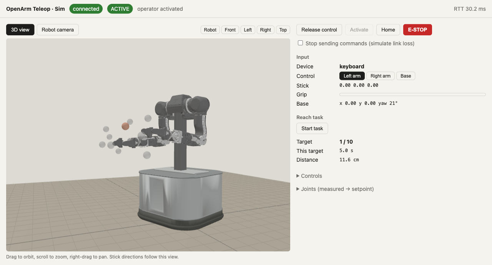
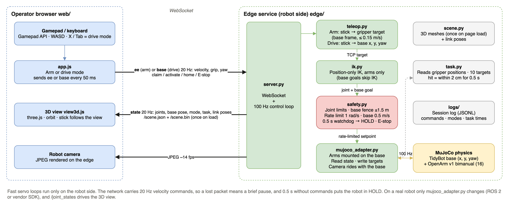

# OpenArm Teleop Sim

第一阶段：不用实体硬件，用 MuJoCo 里的 OpenArm v1 双臂（立柱款，16 个执行器：每臂 7 关节 + 夹爪），打通"控制指令 → 边缘安全层 → 状态反馈 → 浏览器前端"。

双臂默认装在移动底盘上：[Stanford TidyBot](https://github.com/google-deepmind/mujoco_menagerie/tree/main/stanford_tidybot) 的底盘（MuJoCo Menagerie，MIT 许可，只用底盘，不含它的 Kinova 机械臂）。底盘是全向的，用 x、y、转角三个平面关节做位置控制，没有轮子物理。启动时加 `--no-base` 回到固定立柱版。



## 运行

```bash
./scripts/fetch_model.sh                 # 拉取 OpenArm 模型和 TidyBot 底盘（固定 commit）
uv run pytest                            # 安全层、IK、遥操作、任务和仿真适配器测试
uv run python -m edge.server             # http://127.0.0.1:8765
```

操作顺序：Claim control → Activate（手柄 Start）→ 用手柄移动夹爪。按手柄 X（PS4 方块）或键盘 Tab 在"动手臂"和"开底盘"两种模式间切换。点 Start task 开始对准任务。没有手柄时用键盘，按键见页面里的 Controls。

| 动作 | 手柄 | 键盘 |
|---|---|---|
| 切换手臂 / 底盘模式 | X（方块） | Tab |
| 手臂模式：夹爪左右、前后移动 | 左摇杆 | A D / W S |
| 手臂模式：夹爪上下移动 | 右摇杆 | R / F |
| 手臂模式：合上夹爪 | 按住 RT | 按住 G |
| 手臂模式：切换左臂 / 右臂 | LB / RB | Q / E |
| 底盘模式：底盘左右、前后平移 | 左摇杆 | A D / W S |
| 底盘模式：原地左转 / 右转 | 右摇杆左右 | Q / E |
| Activate / Home（只回手臂，底盘不动）/ E-stop | Start / Y / B | Enter / H / 空格 |

画面有两个标签：**3D view**（默认）在浏览器里按关节状态画出机器人，可拖动旋转、滚轮缩放、右键平移，右上角有 Robot / Front / Left / Right / Top 预设视角；**Robot camera** 是边缘端渲染的相机画面，相机装在底盘后上方，跟着底盘走和转（将来对应真机相机）。底盘移动时 3D 视图只跟着平移、不跟着转，所以摇杆方向不会在操作中突然变；预设视角以底盘当前位置和朝向为准。3D 视图需要 WebGL，three.js 从 jsDelivr CDN 加载。

方向以当前画面为准：摇杆向上 = 画面里向前，开底盘和动手臂都一样。在 3D 视图里转到哪个方向，摇杆就跟着那个方向。只控制夹爪中心的位置，不控制手腕姿态。夹爪目标记在底盘坐标系里，所以开底盘时手臂跟着车走，姿态不变。勾选 "Stop sending commands" 可模拟断网。

对准任务：10 个目标点按顺序亮起（橙色），位置相对底盘起点（随底盘高度抬高 0.335 m），原地就能全部够到，暂时不需要开车；任一夹爪中心在目标 2 cm 内停留 0.5 s 算完成，变绿。页面和 `logs/` 记录每个目标的用时。

## 结构（与真实边缘设备一一对应）



| 文件 | 作用 | 换成真机时 |
|---|---|---|
| `edge/mujoco_adapter.py` | 机器人替身：把双臂装到底盘上；关节名、限位（底盘限制在起点 ±1.5 m 内）、读状态、写目标、相机画面 | 换成 ROS 2 或供应商 SDK 适配器，接口不变 |
| `edge/ik.py` | 单臂位置 IK：阻尼最小二乘，零空间拉向初始姿态 | 换成真机的模型，算法不变 |
| `edge/teleop.py` | 摇杆速度（画面坐标）→ 夹爪目标（底盘坐标系）→ IK → 关节目标；够不到时目标不再往外跑。底盘模式把摇杆积分成底盘 x、y、转角目标 | 保留；关节名表按机器人改 |
| `edge/task.py` | 对准任务：目标点、成功判定、每个目标用时 | 保留 |
| `edge/scene.py` | 3D 视图用的模型网格（体素聚类降采样，约 2 MB）和各 link 位姿 | 真机时位姿来自 `/joint_states` 正运动学 |
| `edge/safety.py` | 本地安全层：限位裁剪、速度限制、0.5 s 看门狗、E-stop 锁存 | 原样保留，跑在机器人本地 |
| `edge/server.py` | 100 Hz 本地控制循环 + WebSocket；单操作员控制权；JSONL 会话日志（`logs/`） | 保留；公网暴露前必须加认证和 TLS |
| `web/` | 操作员界面：3D 视图、相机画面、手柄 / 键盘输入、任务面板、模式、RTT | 保留 |

协议：浏览器以 20 Hz 发送 `ee`（当前手臂、三轴速度 −1…1、夹爪 0…1；在 3D 视图里另带 `yaw`，即视角朝向），开底盘时改发 `base`（右、前、右转三个分量 −1…1，同样可带 `yaw`），边缘端以 20 Hz 回 `state`（含各 link 位姿），约 14 fps 回 JPEG。网格只在打开页面时从 `/scene.json`、`/scene.bin` 取一次。发送的是速度而不是位置，所以丢一包只会短暂停顿。IK 的结果仍要经过安全层，高频伺服不经过网络。底盘的三个目标和手臂关节走同一个安全层：限速 0.5 m/s、1 rad/s，断联 HOLD，E-stop 停在实测位置。

## 已验证

- 目标超出限位会被裁剪；setpoint 移动速度不超过 1 rad/s。
- 停发指令 0.5 s 后进入 HOLD，停在当前 setpoint；重新 Activate 时不跳变。
- 反复 HOLD/Activate 不会因重力下垂而累积漂移。
- E-stop 锁存，必须重新 Activate；任何连接的客户端都能触发 E-stop。
- 满杆时夹爪按 0.15 m/s 移动；消息间隔超过 0.1 s 不补算；目标够不到时不会越跑越远。
- 10 个目标点都在 IK 可达范围内（误差 ≤ 2 mm）。
- 浏览器中用模拟手柄跑通：完成第 1 个目标；手柄 B 触发 E-stop，Start 恢复。
- 3D 视图：五个预设视角和拖动旋转正常；在 Left 视角按"前"，指令带 yaw = −90°，夹爪朝远离镜头方向移动。
- 底盘：满杆前进 0.4 m/s、转向 0.8 rad/s；底盘转 90° 后，夹爪仍按画面方向移动；Home 不动底盘；超出 ±1.5 m 的目标被裁剪；底盘移动 0.3 m，两个夹爪在世界坐标里跟着移动 0.3 m。
- 浏览器中用键盘跑通：Tab 切到底盘模式，W 开 2 s 到 x = 0.80 m，E 转 1.5 s 到 −68°；切回手臂模式后底盘不动。

## 这一阶段证明不了的

- 真实网络下的延迟和抖动（本地 RTT 约 1 ms）。
- 供应商机器人的真实接口、固件版本和控制器行为。
- 底盘的真实物理：这里的底盘没有轮子，不会打滑、侧翻或陷进地里，也不受地形影响；差速或履带底盘的手感不同。
- 拖管等浇水任务本身的物理难点。
- 视频走 WebSocket JPEG，只适合仿真；跨洋链路需要换成 WebRTC。

运行原理图解（中文，滑块版，尚未更新为手柄版）：[docs/运行原理.html](docs/运行原理.html)
